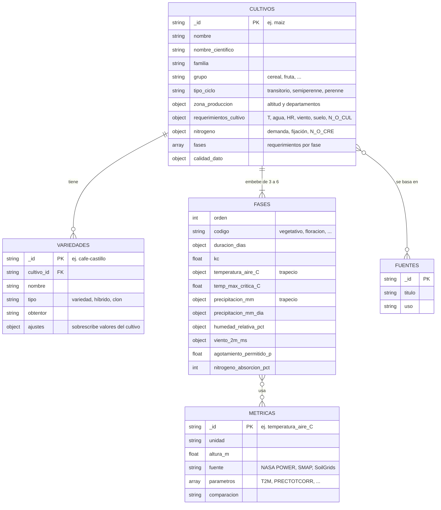
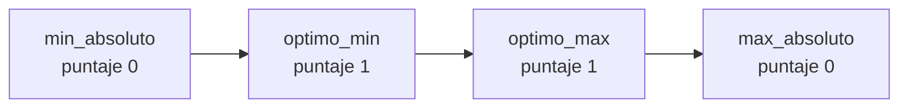
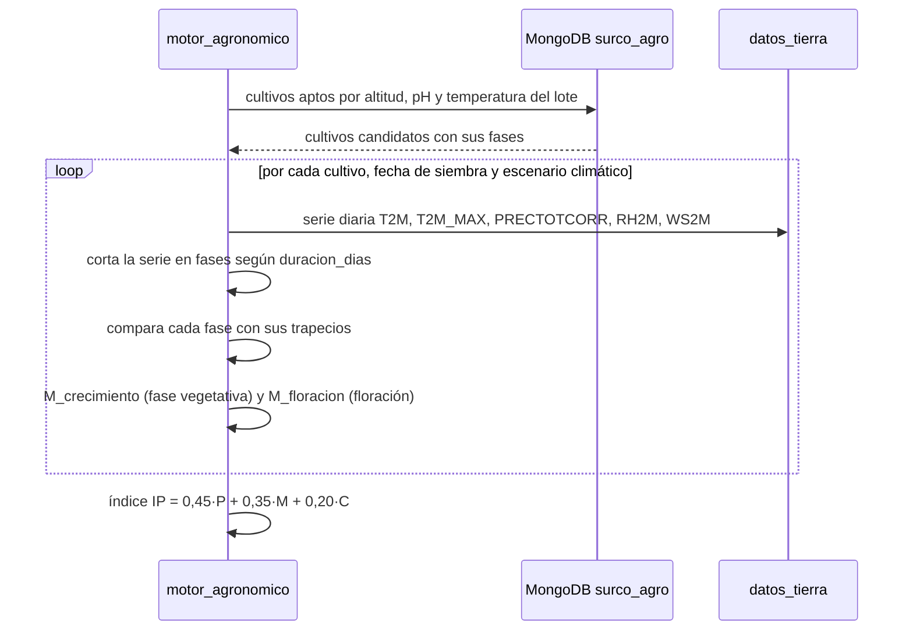

# 🌾 Catálogo agronómico de cultivos de Colombia · MongoDB

Base de datos `surco_agro` con los requerimientos de **44 cultivos principales de Colombia** y **81 variedades o tipos comerciales**, organizada para que el modelo predictivo de SURCO sepa **qué condiciones necesita cada cultivo en cada fase**, desde la siembra hasta la cosecha.

> ⚠️ **Calidad de los datos:** los valores son **de referencia** (FAO-56, FAO ECOCROP y literatura agronómica general). Sirven para construir y probar el modelo, pero **deben validarse** con Agrosavia, los gremios (Cenicafé, Fedearroz, Cenicaña, Fedepalma, Fedecacao) y un agrónomo antes de usarse con productores reales. Cada documento lo indica en `calidad_dato.validado: false`.

---

## 1. Dos correcciones importantes antes de empezar

| Lo que se pidió | Lo que usamos | Por qué |
|---|---|---|
| Temperatura a 3 metros | **Temperatura a 2 m** (`T2M`, `T2M_MAX`, `T2M_MIN`) | NASA POWER mide a 2 m; no existe una variable a 3 m. Si guardáramos umbrales "a 3 m", no habría dato con qué compararlos |
| Nivel de viento | **Viento a 2 m** (`WS2M`) en m/s | Es la altura estándar de FAO-56 y la que usa el cálculo de evapotranspiración. POWER también ofrece `WS10M` |
| Agua requerida | **Precipitación en mm**, comparable con `PRECTOTCORR` (mm/día) | Es el dato que nos llega; cada fase trae el total en mm y su equivalente en mm/día |

## 2. Qué significan N_O_CUL y N_O_CRE

| Campo | Significado | Unidad | Con qué se compara |
|---|---|---|---|
| **N_O_CUL** | Nitrógeno **total** óptimo en el suelo para el cultivo | g/kg | SoilGrids `nitrogen` (cg/kg) ÷ 100 |
| **N_O_CRE** | Nitrógeno que el cultivo debe tener disponible **durante el crecimiento vegetativo** | kg N/ha | Aporte del suelo + rotación (leguminosas) + fertilización |

Además, **cada fase** tiene `nitrogeno_absorcion_pct` (qué porcentaje del nitrógeno total absorbe en esa fase) y `nitrogeno_kg_ha`. Así el modelo sabe no solo cuánto nitrógeno necesita el cultivo, sino **cuándo**.

> 📌 SoilGrids entrega nitrógeno **total**, que es un indicador de fertilidad, no el nitrógeno que la planta puede usar de inmediato. Por eso N_O_CUL está en g/kg (para compararlo con SoilGrids) y N_O_CRE en kg/ha (para decisiones de manejo).

## 3. Modelo de datos



| Colección | Documentos | Para qué |
|---|---|---|
| `cultivos` | 44 | Un documento por cultivo con sus requerimientos generales y sus **fases embebidas** |
| `variedades` | 81 | Variedades, híbridos, clones o tipos comerciales; `ajustes` permite que una variedad cambie, por ejemplo, la duración del ciclo |
| `metricas` | 11 | Diccionario de cada métrica: unidad, altura, fuente NASA y **cómo compararla** |
| `fuentes` | 7 | Referencias que respaldan los valores |

**¿Por qué las fases van embebidas y no en otra colección?** Cada cultivo tiene entre 3 y 6 fases, siempre se leen juntas y casi nunca cambian. Embeberlas permite traer todo el cultivo en **una sola lectura**, que es el patrón recomendado en MongoDB para arreglos pequeños y acotados.

## 4. El trapecio: cómo se guarda cada condición óptima

Cada métrica clave se guarda como un **trapecio** de cuatro valores, el mismo que usa el índice IP del modelo de pesos:



Por debajo de `min_absoluto` o por encima de `max_absoluto` el cultivo no prospera; entre `optimo_min` y `optimo_max` está en su punto ideal; en medio, el puntaje sube o baja de forma lineal.

**Ejemplo real del catálogo · Maíz, fase de floración**

| Métrica | min_absoluto | optimo_min | optimo_max | max_absoluto |
|---|---|---|---|---|
| Temperatura a 2 m (°C) | 10 | 18 | 30 | 38 |
| Precipitación en la fase (mm) | 90 | 112 | 120 | 180 |

Además: temperatura máxima crítica de 35 °C, lluvia óptima de 5.3 a 5.7 mm/día, viento tolerable hasta 9.0 m/s, Kc de 1.2 y 25 % del nitrógeno total absorbido en esta fase.

### Cómo se calcularon los valores por fase
- **Duración:** fracción típica de cada fase según la plantilla fenológica del cultivo (por ejemplo, en granos: 15 % establecimiento, 30 % vegetativo, 15 % floración, 25 % llenado y 15 % maduración).
- **Precipitación:** la necesidad mínima y óptima se reparte según el **consumo de agua** de cada fase (duración × Kc de FAO-56); los límites de exceso se reparten según la **duración**. Así una fase corta con mucho consumo, como la floración, pide más agua por día.
- **Temperatura en floración:** el óptimo se ajusta para quedar por debajo de la temperatura crítica del cultivo.
- **Agotamiento permitido p:** en floración se reduce un 20 %, porque es la fase más sensible al estrés hídrico.

## 5. Cómo lo usa el modelo predictivo



| Métrica | Variable NASA | Cómo se compara |
|---|---|---|
| `temperatura_aire_C` | `T2M` | Promedio de la fase contra el trapecio |
| `temp_max_critica_C` | `T2M_MAX` | Días de la fase por encima de la crítica |
| `precipitacion_mm` | `PRECTOTCORR` + riego | Suma de la fase contra el trapecio |
| `humedad_relativa_pct` | `RH2M` | Promedio contra el rango óptimo |
| `viento_2m_ms` | `WS2M` | Porcentaje de días por encima del tolerable |
| `agotamiento_permitido_p` | SMAP zona radicular | Se riega cuando el agotamiento supera p × agua total disponible |
| `N_O_CUL` | SoilGrids `nitrogen` | Valor del lote contra el trapecio |
| `ph` | SoilGrids `phh2o` | Valor del lote contra el trapecio |

El archivo `scripts/ejemplo_modelo.py` implementa esta comparación. Con una serie de prueba parecida al valle de Neiva, el maíz sale bien en la fase vegetativa, pero mal en floración y llenado por **calor y falta de lluvia**. Es justo el tipo de alerta que el sistema debe dar: sin riego, esa siembra es riesgosa.

## 6. Cultivos incluidos

| Cultivo | Grupo | Altitud (msnm) | T óptima (°C) | Agua óptima | Fases | Variedades |
|---|---|---|---|---|---|---|
| Arroz (riego) | Cereales | 0–1200 | 22–30 | 1000–1800 mm/ciclo | 5 | 2 |
| Arroz (secano mecanizado) | Cereales | 0–800 | 22–30 | 800–1200 mm/ciclo | 5 | 1 |
| Maíz | Cereales | 0–2800 | 18–30 | 500–800 mm/ciclo | 5 | 3 |
| Sorgo | Cereales | 0–1500 | 25–32 | 400–650 mm/ciclo | 5 | 1 |
| Fríjol | Leguminosas | 500–2800 | 16–24 | 300–500 mm/ciclo | 5 | 3 |
| Soya | Leguminosas | 0–1200 | 20–30 | 450–700 mm/ciclo | 5 | 1 |
| Arveja | Leguminosas | 1800–3000 | 12–20 | 300–450 mm/ciclo | 5 | 1 |
| Maní | Leguminosas | 0–1200 | 25–30 | 500–700 mm/ciclo | 5 | 1 |
| Papa | Tubérculos | 2000–3500 | 12–20 | 500–750 mm/ciclo | 5 | 2 |
| Papa criolla | Tubérculos | 2200–3200 | 12–18 | 400–600 mm/ciclo | 5 | 1 |
| Yuca | Raíces | 0–1800 | 22–30 | 1000–1500 mm/año | 5 | 2 |
| Ñame | Raíces | 0–1000 | 25–30 | 1200–1800 mm/año | 5 | 2 |
| Arracacha | Raíces | 1800–2600 | 15–20 | 800–1200 mm/año | 5 | 1 |
| Tomate | Hortalizas | 0–2000 | 18–27 | 450–650 mm/ciclo | 5 | 2 |
| Pimentón | Hortalizas | 0–1800 | 18–28 | 500–800 mm/ciclo | 5 | 1 |
| Ahuyama | Hortalizas | 0–2000 | 20–30 | 400–600 mm/ciclo | 5 | 1 |
| Cebolla de bulbo | Hortalizas | 800–2800 | 13–24 | 400–600 mm/ciclo | 4 | 1 |
| Cebolla larga | Hortalizas | 1800–3200 | 12–20 | 500–800 mm/ciclo | 4 | 1 |
| Zanahoria | Hortalizas | 1800–3000 | 15–21 | 400–600 mm/ciclo | 5 | 2 |
| Repollo | Hortalizas | 1500–3000 | 15–20 | 380–500 mm/ciclo | 4 | 1 |
| Lechuga | Hortalizas | 1500–2800 | 15–20 | 250–400 mm/ciclo | 4 | 2 |
| Aguacate Hass | Frutales | 1700–2500 | 14–24 | 1200–1600 mm/año | 4 | 1 |
| Aguacate tropical (antillano) | Frutales | 0–1500 | 20–30 | 1200–1800 mm/año | 4 | 3 |
| Mango | Frutales | 0–1200 | 24–30 | 800–1500 mm/año | 4 | 4 |
| Cítricos | Frutales | 0–1800 | 20–30 | 1200–1800 mm/año | 4 | 3 |
| Guayaba | Frutales | 0–1800 | 23–30 | 1000–2000 mm/año | 4 | 2 |
| Piña | Frutales | 0–1600 | 22–30 | 1000–1500 mm/año | 5 | 3 |
| Papaya | Frutales | 0–1200 | 22–30 | 1200–2000 mm/año | 4 | 2 |
| Maracuyá | Frutales | 0–1300 | 23–30 | 1200–1800 mm/año | 4 | 1 |
| Granadilla | Frutales | 1600–2400 | 16–22 | 1500–2500 mm/año | 4 | 1 |
| Mora de Castilla | Frutales | 1800–2800 | 12–18 | 1500–2500 mm/año | 4 | 2 |
| Lulo | Frutales | 1600–2400 | 16–20 | 1500–2500 mm/año | 4 | 2 |
| Tomate de árbol | Frutales | 1600–2600 | 14–20 | 1500–2000 mm/año | 4 | 2 |
| Uchuva | Frutales | 1800–2800 | 13–18 | 1000–2000 mm/año | 4 | 1 |
| Fresa | Frutales | 1800–2800 | 15–20 | 700–1200 mm/año | 4 | 2 |
| Banano | Frutales | 0–600 | 22–32 | 1800–2500 mm/año | 5 | 3 |
| Plátano | Frutales | 0–2000 | 22–30 | 1500–2500 mm/año | 5 | 3 |
| Café | Café y cacao | 1200–2000 | 18–22 | 1600–2500 mm/año | 4 | 4 |
| Cacao | Café y cacao | 0–1200 | 22–30 | 1500–2500 mm/año | 4 | 3 |
| Caña de azúcar | Industriales | 0–1200 | 24–32 | 1500–2500 mm/año | 4 | 2 |
| Caña panelera | Industriales | 700–2000 | 22–30 | 1500–2500 mm/año | 4 | 1 |
| Palma de aceite | Industriales | 0–500 | 24–32 | 1800–2500 mm/año | 4 | 2 |
| Algodón | Industriales | 0–1000 | 22–32 | 700–1300 mm/ciclo | 5 | 1 |
| Crotalaria (abono verde) | Abono verde | 0–1500 | 22–32 | 300–500 mm/ciclo | 3 | 1 |

Los cultivos perennes guardan el agua **por año productivo**, y sus fases describen el ciclo anual (brotación, floración, desarrollo del fruto, cosecha). El tiempo hasta la primera cosecha va en `ciclo.establecimiento_dias`.

## 7. Cómo instalar

```bash
# 1. Crear colecciones con validación e índices
mongosh "mongodb://localhost:27017" scripts/01_crear_base.js

# 2. Cargar los datos (se puede repetir; actualiza sin duplicar)
mongosh "mongodb://localhost:27017" scripts/02_cargar_datos.js

# 3. Probar las consultas de ejemplo
mongosh "mongodb://localhost:27017/surco_agro" scripts/03_consultas_ejemplo.js

# 4. Probar el uso desde el modelo (Python)
SURCO_MONGO_URI="mongodb://localhost:27017" python scripts/ejemplo_modelo.py
```

Ejecuta los comandos desde la carpeta raíz del paquete. Si no, define `SURCO_AGRO_DIR` con la ruta.

Alternativa sin scripts: `mongoimport --db surco_agro --collection cultivos --jsonArray --file datos/cultivos.json` (repetir para cada colección; así no se aplica el validador).

## 8. Reglas de integridad

- Cada colección tiene un **validador `$jsonSchema`** (carpeta `esquemas/`): MongoDB rechaza documentos sin los campos obligatorios o con valores fuera de los tipos permitidos.
- Todos los documentos fueron validados contra esos esquemas antes de entregarlos; también se verificó que cada trapecio esté ordenado, que las fracciones de las fases sumen 1 y que la absorción de nitrógeno sume 100 %.
- Para agregar un cultivo: copia un documento del mismo grupo, ajusta los valores, cita la fuente en `calidad_dato.fuentes` y deja `validado: false` hasta que lo revise un agrónomo.

## 9. Valores aproximados por análogo

Cinco cultivos no tenían Kc, profundidad de raíz (Zr) ni agotamiento permitido (p), y sin ellos no se puede calcular su balance hídrico. Se completaron con FAO-56 tomando un cultivo de la **misma familia o género**, con la misma regla que ya usa el catálogo para pasar de cultivo a fase. Cada documento lo registra en `calidad_dato.aproximaciones` (análogo, parentesco, confianza y nota), y su `version` subió a 2.

| Cultivo | Análogo | Parentesco | Kc ini / mid / end | Zr (m) | p | Confianza |
|---|---|---|---|---|---|---|
| Arracacha | Zanahoria | Apiaceae, raíz reservante | 0,70 / 1,05 / 0,95 | 0,5 | 0,35 | Media |
| Mora de Castilla | *Berries* de FAO-56 (frambuesa, zarzamora) | Mismo género *Rubus* | 0,30 / 1,05 / 0,50 | 0,9 | 0,50 | Media: el Kc ini es de zarzas templadas que pierden la hoja |
| Lulo | Berenjena | Mismo género *Solanum* | 0,60 / 1,05 / 0,90 | 0,7 | 0,45 | Media |
| Uchuva | Tomate | Solanaceae, indeterminada y tutorada | 0,60 / 1,15 / 0,80 | 0,8 | 0,40 | Media |
| Crotalaria | Soya | Fabaceae, leguminosa anual | (ya tenía Kc) | 0,9 | 0,50 | Media |

**No se completaron** (siguen en `null`) porque no hay un pariente en FAO-56 que dé valores defendibles:

| Cultivo | Por qué no | Dónde buscar el dato |
|---|---|---|
| Ñame | Dioscoreaceae: FAO-56 no trae ningún pariente; yuca y batata son de otras familias y otro hábito | Estudios de IITA (África occidental), Agrosavia Caribe |
| Mango | Anacardiaceae: el único pariente en FAO-56 es el pistacho, caducifolio y de zonas áridas | Estudios con lisímetro de Embrapa (Brasil) |
| Guayaba | Myrtaceae: ningún pariente en FAO-56 | Embrapa; literatura de India |
| Papaya | Caricaceae: ningún pariente; planta herbácea gigante con raíz superficial y muy sensible al encharcamiento | Embrapa Mandioca e Fruticultura |
| Maracuyá | Passifloraceae: ningún pariente en FAO-56; la vid se parece en el tutorado, pero no en la fisiología | Embrapa; literatura colombiana |
| Granadilla | Passifloraceae, como el maracuyá: sería aproximar sobre otra aproximación | Agrosavia, Universidad Nacional |
| Tomate de árbol | Mismo género que la berenjena, pero es un árbol de 3 m que vive de 8 a 10 años | Agrosavia, Universidad Nacional |

Mientras no tengan Kc, Zr y p, el oráculo del modelo predictivo evalúa estos 7 cultivos solo con los trapecios de clima y no calcula su riego.

> Pendiente: la lluvia por fase de los cultivos completados se había repartido por duración, porque no tenían Kc. La regla del catálogo la reparte por consumo (duración × Kc). Conviene recalcularla con los Kc nuevos.

## 10. Decisión de arquitectura (proponer como ADR-014)

> ❗ **Esto agrega MongoDB a la arquitectura**, que hasta ahora solo tenía PostgreSQL. La justificación: el catálogo agronómico es **información de referencia, de solo lectura y con estructura variable** por tipo de cultivo (los perennes, las musáceas y los granos tienen fases distintas), y el modelo documental lo representa de forma natural.
>
> Reglas para que no rompa el monolito modular: solo el módulo `motor_agronomico` lee `surco_agro`; los datos de usuarios, lotes y planes siguen en PostgreSQL; el catálogo se versiona con el campo `version`. **Alternativa descartada:** guardar el catálogo como `jsonb` en PostgreSQL, que evita un componente más pero hace más difícil validar y consultar las fases.
