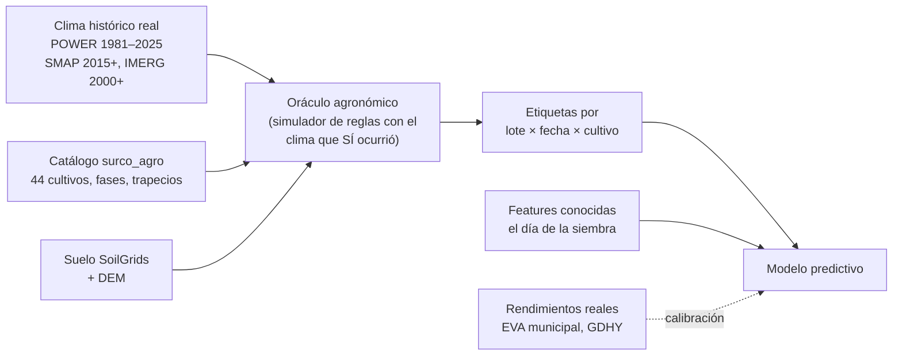
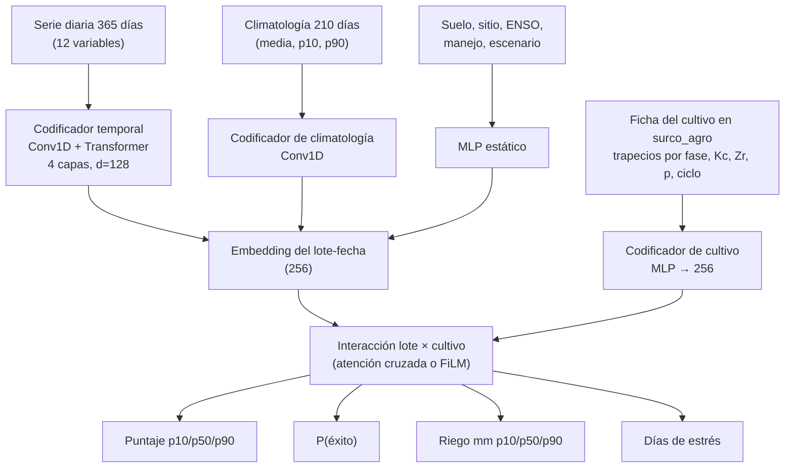
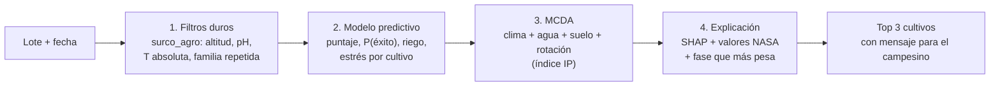

# Motor de IA de SURCO: modelo predictivo de idoneidad de cultivos

> **Para empezar a trabajar en la máquina de entrenamiento: [GUIA_MAQUINA_GPU.md](GUIA_MAQUINA_GPU.md).**
>
> Estado: propuesta de arquitectura, 2026-10-17. Complementa la [ADR 0001](../docs/decisiones/0001-motor-mcda-explicable.md) y no la reemplaza: el MCDA sigue siendo la capa que filtra y explica, y el modelo aporta lo que las reglas solas no pueden hacer, que es **anticipar** cómo le va a ir a cada cultivo.

## 1. Qué problema resuelve el modelo

El productor pregunta: *"Si siembro en este lote en esta fecha, ¿qué cultivo me conviene?"*.

El catálogo `surco_agro` ya sabe qué condiciones necesita cada cultivo en cada fase (los trapecios de temperatura, lluvia, humedad relativa y viento). El problema es que, **el día de la siembra, todavía no sabemos qué clima va a hacer** durante los 100 a 180 días del ciclo. Las reglas solo se pueden evaluar con el clima que ya pasó.

Por eso el modelo predice, con la información disponible el día de la decisión, **cómo van a puntuar los trapecios del catálogo con el clima que realmente ocurra**:

| Entrada (conocida el día de la siembra) | Salida (lo que pasará en el ciclo) |
|---|---|
| Clima de los últimos 365 días del lote | Puntaje de idoneidad 0–1 por cultivo, con intervalo (p10, p50, p90) |
| Humedad del suelo SMAP al sembrar | Probabilidad de completar el ciclo sin falla crítica ("8 de cada 10 años") |
| Climatología histórica de los próximos meses | Lámina de riego necesaria (mm) |
| Estado de El Niño / La Niña (ONI) | Días de estrés hídrico (Ks < 1) y días de calor crítico en floración |
| Suelo, altitud, ubicación y fecha | |
| Escenario: +°C de calentamiento, −% de lluvia | |

El modelo **no aprende las reglas**, que ya están en el catálogo. Aprende **a anticipar qué hará el clima con cada cultivo**. Ese es el valor que el MCDA solo no tiene y lo que lo justifica ante los jueces.

## 2. El problema de las etiquetas y cómo lo resolvemos

No existe un dataset de "este cultivo fue bueno en este lote" para Colombia. La solución es **generar las etiquetas con un oráculo agronómico** sobre 44 años de clima histórico y después **calibrarlas con rendimientos reales**.



**Etapa 1: el oráculo.** Para cada punto, fecha de siembra y cultivo, el oráculo toma el clima que **realmente** pasó durante el ciclo y calcula:
- el puntaje de cada fase contra sus trapecios (lo que ya hace [`ejemplo_modelo.py`](../data/catalogo_cultivos_mongodb/scripts/ejemplo_modelo.py)),
- el balance hídrico diario con ET0 FAO-56, Kc por fase, TAW, RAW y Ks (las fórmulas 4.2 a 4.15 de [`agronomic_engine`](../scripts/data/agronomic_engine/README.md)),
- los días sobre la temperatura crítica en floración.

Con eso se obtienen las etiquetas: puntaje, éxito sí/no, mm de riego y días de estrés.

**Etapa 2: el modelo.** Aprende a predecir esas etiquetas **usando solo lo que se sabe el día de la siembra**. Ninguna feature puede venir del período del ciclo; la única excepción es la climatología, porque es un promedio histórico conocido de antemano.

**Etapa 3: la calibración.** Las etiquetas heredan los umbrales del catálogo, que todavía tiene `validado: false`. Para anclarlas a la realidad usamos:
- **EVA** (Evaluaciones Agropecuarias Municipales, Agronet / datos.gov.co): rendimiento por municipio, cultivo y año.
- **GDHY** (Global Dataset of Historical Yields): rendimiento de maíz, arroz y soya en grilla de 0,5°.

El modelo agregado a municipio y año debe correlacionar con las anomalías de rendimiento. Si no correlaciona, el problema está en los umbrales del catálogo y se corrigen ahí. La probabilidad de éxito se ajusta con regresión isotónica contra esos datos.

### Volumen del dataset

| Dimensión | Valor propuesto | Por qué |
|---|---|---|
| Puntos | ~600 en zonas agrícolas de Colombia, con más densidad en el Huila | Variedad de pisos térmicos; se eligen con MODIS Land Cover `MCD12Q1` (clase cultivos) |
| Años | 1981–2024 (44) | Toda la serie de POWER, con varios ciclos de El Niño y La Niña |
| Fechas de siembra | 24 por año (cada 15 días) | Permite responder "¿cuándo sembrar?" |
| Cultivos | 44 (todo el catálogo) | Una sola pasada del modelo puntúa todos |

Resultado: **~630 mil situaciones lote-fecha**, cada una con 44 cultivos × 5 etiquetas, es decir **~28 millones de simulaciones** del oráculo. Con NumPy vectorizado o Numba se calculan en minutos u horas en CPU.

Las series diarias se guardan **una sola vez por punto** (600 × 16 mil días × ~12 variables ≈ 400 MB en Parquet) y las ventanas de entrenamiento se cortan al vuelo. No se duplican secuencias en disco.

### Aumento de datos para el simulador de escenarios

Durante el entrenamiento se aplica a la serie un desplazamiento aleatorio de temperatura (0 a +4 °C) y un factor de lluvia (−40 % a +20 %), tanto en las features como en el clima que ve el oráculo, y el desplazamiento entra como feature. Así el modelo responde en vivo los controles del simulador del frontend sin volver a ejecutar el oráculo.

## 3. Features

| Grupo | Variables | Fuente | Nota |
|---|---|---|---|
| Clima reciente | Medias, sumas y extremos de 30, 90 y 365 días de T2M, T2M_MAX, T2M_MIN, PRECTOTCORR, RH2M, WS2M, ALLSKY_SFC_SW_DWN, ET0 | NASA POWER | Temperatura **corregida por elevación** (ADR 0002) |
| Humedad del suelo | `sm_rootzone` y `sm_surface` al sembrar y su tendencia de 30 días | SMAP L4 | Desde 2015-03; antes va con máscara y una bandera de disponibilidad |
| Lluvia satelital | Suma de 30 y 90 días | GPM IMERG V07 | Desde 2000-06; misma máscara |
| Climatología futura | Media, p10 y p90 histórico de T y lluvia para los próximos 210 días de ese punto, sin incluir el año evaluado | POWER | Conocida de antemano: no es fuga de información |
| ENSO | ONI del último trimestre y su tendencia | NOAA CPC | Principal fuente de predictibilidad estacional en Colombia |
| Suelo | Arena, arcilla, SOC, pH, CEC, N, CFVO y densidad aparente en Q0.5 ponderado hasta la raíz, más el ancho Q0.95−Q0.05 como incertidumbre | SoilGrids | Mismas conversiones de `normalizer.py` |
| Sitio | Altitud del DEM, lat, lon, distancia a la cordillera | Copernicus DEM GLO-30 | |
| Fecha | Seno y coseno del día del año | | |
| Manejo | Tiene riego, tipo de riego | Registro del productor (paso 3 del wizard) | |
| Escenario | ΔT, factor de lluvia | Simulador | Solo con el aumento de datos |
| Cultivo | Trapecios por fase, Kc, Zr, p, duración del ciclo, familia y tipo de ciclo | `surco_agro` | Ver la sección 4 |

## 4. Arquitectura del modelo

Proponemos **dos modelos en orden**. El primero es obligatorio; el segundo se entrena solo si el primero ya funciona y hay tiempo.

### Modelo A: gradient boosting multi-cultivo (base, obligatorio)

- **XGBoost** con `device="cuda"`, o LightGBM, sobre una tabla de una fila por lote × fecha × cultivo, con las features del cultivo como columnas.
- Un modelo por etiqueta: regresión por cuantiles para puntaje y riego (p10, p50, p90), clasificación binaria para el éxito.
- Con `QuantileDMatrix`, los 28 M de filas × ~150 features ocupan ~4 GB en la GPU y caben en los 16 GB.
- **Por qué primero:** en datos tabulares sigue siendo lo más fuerte; se entrena en minutos; SHAP explica cada predicción, lo que respeta el espíritu de la ADR 0001, y la inferencia en CPU cuesta milisegundos en el backend.

### Modelo B: SurcoNet, red neuronal de secuencias (mejora)

Su ventaja frente al gradient boosting: lee la **serie diaria completa** en lugar de agregados y comparte lo que aprende entre cultivos.



Decisiones clave:
- **El cultivo entra como su ficha del catálogo, no como un ID.** Si un agrónomo corrige un trapecio o se agrega una variedad, el modelo la puntúa sin reentrenar desde cero. Así el catálogo de Mongo sigue siendo la fuente de verdad.
- **Una pasada por lote-fecha puntúa los 44 cultivos**: el lote se codifica una sola vez y se cruza con los 44 embeddings.
- **Multitarea**: la pérdida combina pinball (cuantiles) y entropía cruzada (éxito), con pesos aprendidos por incertidumbre.
- **Tamaño**: 3 a 6 M de parámetros. Con *batch* de 512 lote-fechas (× 44 cultivos) y bf16 usa unos 6 a 10 GB de los 16 GB.

### Perennes y semiperennes

Café, cacao, aguacate y los demás cultivos de varios años no dependen de una fecha de siembra. Usan el mismo modelo con una ventana anual: el puntaje es el promedio de 12 meses del ciclo productivo, y la duración hasta la primera cosecha se toma de `ciclo.establecimiento_dias`.

## 5. Cómo encaja en el motor de recomendación

El modelo es un paso dentro del motor, no todo el motor.



- Los **filtros duros** siguen siendo reglas: el modelo nunca recomienda un cultivo que el catálogo descarta.
- El modelo alimenta los componentes del índice IP que dependen del clima (puntajes de fase y riesgo). La parte de rotación (familias botánicas y aporte de nitrógeno) sigue siendo regla. **Hay que confirmar con quien definió el modelo de pesos qué mide exactamente cada término de `IP = 0,45·P + 0,35·M + 0,20·C`** y conectar cada uno a su salida.
- La **explicación** combina el SHAP del modelo A ("lo que más pesó fue La Niña y la humedad SMAP de 0,15") con el detalle por fase del oráculo, siguiendo la cadena dato → indicador → decisión → mensaje del [informe 08](../docs/investigacion/08_INFORME_FUENTES_Y_FORMULAS.md#7-guía-para-convertir-los-datos-en-recomendaciones-para-el-campesino).

## 6. Validación: cómo demostramos que sirve

| Regla | Detalle |
|---|---|
| Corte por tiempo | Entrenar 1981–2014, validar 2015–2018, **probar 2019–2024**. La prueba incluye La Niña 2020–2022 y El Niño 2023–2024 |
| Corte por espacio | Dejar **todo el Huila fuera** en una corrida, para medir si generaliza a una zona que no vio |
| Sin fuga | La climatología se calcula sin el año evaluado; ninguna feature toca fechas posteriores a la siembra |

**La línea base que hay que vencer:** el mismo oráculo evaluado con la **climatología** en lugar del clima real, que es lo que haría un MCDA sin modelo. Si el modelo no le gana, no aporta y nos quedamos con el MCDA.

| Métrica | Para qué |
|---|---|
| MAE y pinball del puntaje | Precisión del puntaje |
| Brier y error de calibración (ECE) de P(éxito) | Que "8 de cada 10 años" sea verdad |
| NDCG@3 por lote-fecha | Que el top 3 de cultivos sea el correcto |
| Spearman contra anomalías de rendimiento de EVA y GDHY | Validez contra la realidad, no solo contra el oráculo |
| Cobertura del intervalo p10–p90 | Que la incertidumbre sea honesta (~80 %) |

## 7. Lo que hay que resolver en el motor de datos antes de entrenar

Revisado en `scripts/data/` (PR #12, ya en `main`):

| # | Hallazgo | Impacto | Acción |
|---|---|---|---|
| 1 | La corrección por elevación (ADR 0002) **no se aplica** en `unificated.py`: solo guarda `cell_elevation_m`. En la muestra de Villavieja (lote a 430 m, celda a 1403 m) `power_t2m_max` da 26 °C en agosto, en el borde de la Tatacoa | El modelo aprendería un valle 6 °C más frío | Aplicar −6,5 °C/km con la elevación del DEM y guardar las columnas `*_corr` |
| 2 | `POWER_PARAMETERS` no pide `T2M`, que es la variable con la que el catálogo compara la temperatura de cada fase | Falta la entrada principal de los trapecios | Agregar `T2M` (y `T2MDEW` para ET0) |
| 3 | No hay ET0 FAO-56 Penman-Monteith implementada; `engine.py` espera recibir `etc` ya calculada | El oráculo no puede hacer el balance hídrico | Implementar la fórmula 4.2 con POWER (Tmax, Tmin, RH, WS2M, radiación, altitud, latitud) |
| 4 | SMAP e IMERG se piden día por día con `getInfo()`, que tiene un límite de 5000 elementos y es lento | Sirve para un lote, no para 600 puntos × 10–25 años | Para entrenar: exportaciones por lotes de Earth Engine (`Export.table`) de una `FeatureCollection` de puntos, partidas por año |
| 5 | `sand_silt_clay_sum_pct` suma cuantiles: en la muestra Q0.05 = 7,7 % y Q0.95 = 243,5 % | Solo Q0.5 (87 %) sirve como control | Usarlo solo como control de calidad sobre Q0.5 |
| 6 | `crops.py` duplica Zr y p para 7 cultivos; el catálogo ya tiene `profundidad_raiz_m` y `agotamiento_permitido_p` para los 44 | Dos fuentes de verdad que se van a desalinear | Leer los parámetros de `surco_agro` |
| 7 | Las coberturas no coinciden: POWER desde 1981, IMERG desde 2000, SMAP desde 2015 | No hay SMAP para los años más antiguos | Máscaras y banderas de disponibilidad en las features (sección 3) |

**Estado:** el servicio [`datos_tierra`](datos_tierra/README.md) resuelve los hallazgos 1 a 5 y el 7. Sirve tanto para la inferencia (`lote`) como para el entrenamiento (`masivo`), con el mismo código, así que las features de entrenamiento y las de producción salen idénticas. El hallazgo 6 queda para el motor agronómico. Detalle en el [estudio de datos](../docs/datos/estudio-datos-modelo.md).

## 8. Entorno de entrenamiento (RTX 5060 Ti 16 GB)

La 5060 Ti es arquitectura **Blackwell** (`sm_120`) y necesita **CUDA 12.8 o superior**. Los paquetes de PyTorch compilados con CUDA 12.4 o anterior no la reconocen.

```bash
python -m venv .venv-ml && source .venv-ml/bin/activate
pip install torch --index-url https://download.pytorch.org/whl/cu128
pip install xgboost lightgbm optuna shap mlflow polars duckdb pyarrow numba \
            pymongo earthengine-api httpx scikit-learn

# Prueba de humo: debe imprimir el nombre de la tarjeta y (12, 0)
python -c "import torch; print(torch.cuda.get_device_name(0), torch.cuda.get_device_capability(0))"
python -c "import xgboost as xgb, numpy as np; xgb.train({'device':'cuda'}, xgb.DMatrix(np.random.rand(1000,10), label=np.random.rand(1000)), 5); print('xgboost GPU ok')"
```

Si XGBoost falla en la GPU, el modelo A también se entrena bien en CPU; solo tarda más.

| Tarea | Dónde corre | Orden de magnitud |
|---|---|---|
| Descarga masiva (POWER, SMAP, IMERG, SoilGrids, DEM) | Red / Earth Engine | 1 a 2 días, limitada por las APIs: se hace una sola vez |
| Oráculo: 28 M de simulaciones | CPU (Numba) | Minutos a horas |
| Modelo A + búsqueda de hiperparámetros con Optuna | GPU | Horas |
| Modelo B, de 30 a 60 épocas | GPU, bf16 | Horas |
| Inferencia en el backend | CPU | Milisegundos por lote |

Los experimentos se registran en **MLflow** local (`mlruns/` va en `.gitignore`). El modelo A se exporta como `.ubj` de XGBoost y el modelo B a **ONNX**, para que el backend en Render no necesite PyTorch.

## 9. Estructura propuesta

```
ml/
  README.md                  este documento
  configs/                   puntos, años, fechas de siembra, hiperparámetros (YAML)
  datos_tierra/              ✅ servicio de datos: lote, masivo y puntos (ver su README)
  surco_ml/
    oraculo/
      simulador.py           trapecios por fase + balance hídrico (reutiliza agronomic_engine)
      etiquetas.py           genera el Parquet de etiquetas
    features/
      construir.py           mismas features en entrenamiento e inferencia
    modelos/
      gbdt.py                modelo A
      surconet.py            modelo B
    evaluacion/
      metricas.py            cortes por tiempo y espacio, línea base de climatología
      calibracion_eva.py     calibración con rendimientos reales
  notebooks/                 exploración; nada de lógica que se use en producción
```

## 10. Ruta de trabajo

| Etapa | Entregable | Criterio para pasar a la siguiente |
|---|---|---|
| **0. Arreglar los datos** | Hallazgos 1 a 6 de la sección 7 resueltos | El lote de Villavieja da T2M_MAX corregida ≈ 32 °C en agosto |
| **1. Oráculo** | `simulador.py` con pruebas unitarias que reproducen los ejemplos del informe 08 y del catálogo | El maíz en Neiva sale mal en floración sin riego, igual que en `ejemplo_modelo.py` |
| **2. Dataset** | Series de 600 puntos, etiquetas y features en Parquet versionados | Sin fugas: prueba automática de que ninguna feature usa fechas posteriores a la siembra |
| **3. Modelo A** | XGBoost con SHAP y métricas de la sección 6 | **Le gana a la línea base de climatología** en 2019–2024 |
| **4. Calibración** | Correlación con EVA/GDHY y P(éxito) calibrada | Spearman positivo y significativo en los cultivos con datos |
| **5. Integración** | Módulo `motor_agronomico` en FastAPI: filtros + modelo + MCDA + explicación | El frontend muestra el top 3 con su "por qué" |
| **6. Modelo B (opcional)** | SurcoNet exportada a ONNX | Mejora NDCG@3 o la calibración frente al modelo A; si no mejora, se queda el A |

**Si el tiempo aprieta**, las etapas 0 a 3 ya dan un producto completo y defendible: un modelo que anticipa el riesgo climático por cultivo, que le gana a una línea base honesta y que se explica con SHAP y con valores NASA.

## 11. Riesgos

| Riesgo | Mitigación |
|---|---|
| Los umbrales del catálogo no están validados, así que el modelo aprende sus errores | Etapa 4 de calibración; mostrar `validado: false` en la demo como una limitación conocida |
| La predictibilidad estacional es limitada fuera de los años con ENSO marcado | Por eso se predicen intervalos y probabilidades, no un único número |
| Celdas de POWER de ~50 km en terreno montañoso | Corrección por DEM + IMERG (11 km) y SMAP (9 km) como features más finas |
| El modelo se vuelve una caja negra ante los jueces | Modelo A + SHAP primero; los filtros duros y el MCDA siempre visibles |
| Se mezclan features de entrenamiento y de producción | Un único `features/construir.py` usado por ambos |

## 12. Referencias de datos nuevos

- **EVA** (Evaluaciones Agropecuarias Municipales): Agronet / UPRA, publicadas en datos.gov.co.
- **GDHY**: Iizumi y Sakai (2020), *Scientific Data* 7, 97.
- **ONI** (índice oceánico de El Niño): NOAA Climate Prediction Center.
- **MODIS Land Cover** `MCD12Q1` v061 y **Copernicus DEM GLO-30**, ambos disponibles en Google Earth Engine.
- Las fuentes NASA, SoilGrids y las fórmulas FAO-56 están en el [inventario](../docs/datos/inventario.md) y en el [informe 08](../docs/investigacion/08_INFORME_FUENTES_Y_FORMULAS.md).
